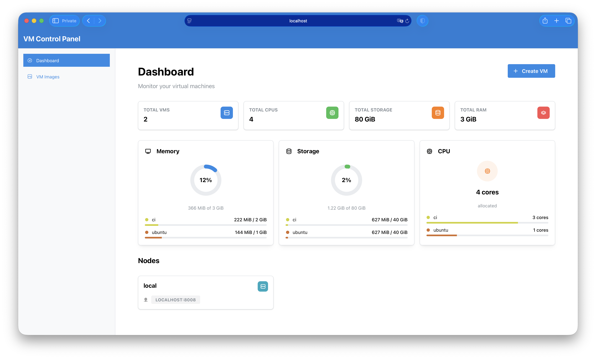
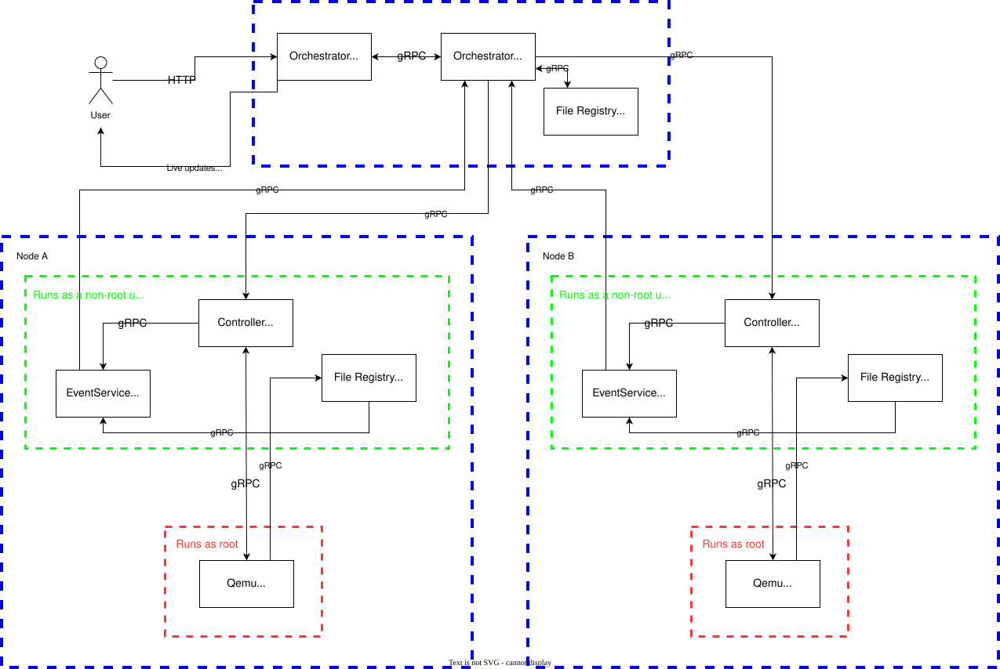

# QEMU VM Controller

`qcontroller` manages QEMU virtual machines across one or more Linux and macOS hosts from a single binary (`qcontrollerd`). It exposes a gRPC and REST API, WebSocket streams for state changes and guest console logs, and an embedded React web UI.

Supported operations:
- **Instance lifecycle**: create, start, stop, remove, and inspect VMs across nodes
- **Snapshots**: save, list, restore, and delete VM snapshots
- **Images**: upload, list, and delete base images; the orchestrator pushes images to target nodes automatically before creating a VM
- **Live streams**: real-time VM state updates (`/ws`) and per-instance console logs (`/ws/logs`)



## Architecture



`qcontrollerd` ships as one binary with five subcommands:

- `qemu` (gRPC): launches and monitors QEMU processes. Runs as root because it creates network interfaces (TAP on Linux, vmnet on macOS).
- `controller` (gRPC): manages VM state on a node, talks to `qemu`, and publishes state transitions to `eventservice`.
- `fileregistry` (gRPC): stores VM base images and serves chunked uploads/downloads. Runs on each node and on the orchestrator.
- `eventservice` (gRPC): pub/sub hub for VM and image events on a node.
- `orchestrator` (HTTP): control plane that connects to one or more nodes over gRPC, distributes images, aggregates events, and serves the REST API, WebSocket streams, OpenAPI spec, and web UI.

Only `qemu` requires root; the other four services run as unprivileged users. Even a single-host setup runs through the orchestrator.

## Getting Started

### macOS Package Installation

Build and install the macOS `.pkg` installer, which sets up `launchd` services automatically:

```bash
./build-macos-pkg.sh
sudo installer -pkg build/qcontrollerd.pkg -target /
```

This installs `/usr/local/bin/qcontrollerd`, registers a LaunchDaemon for `qemu` and LaunchAgents for the unprivileged services, and starts them.

To uninstall:
```bash
sudo /usr/local/share/com.github.qcontroller.qcontrollerd/uninstall.sh
```

### Debian/Ubuntu Package Installation

Build and install the `.deb` package:

```bash
# Build the binary and package it. Set GOARCH for cross-arch.
make install-tools                          # one-time setup
make deb PKG_VERSION=0.0.1                  # native arch
GOARCH=arm64 make deb PKG_VERSION=0.0.1     # cross-compile

# apt drops privileges to the unprivileged _apt user when reading the
# .deb (sandboxing), which can't read files in your source tree. Move
# the package to a world-readable location like /tmp first.
cp build/qcontrollerd_0.0.1_amd64.deb /tmp/

# Install (this also creates system users and starts all services)
sudo apt install /tmp/qcontrollerd_0.0.1_amd64.deb
```

The package installs:
- Binary at `/usr/bin/qcontrollerd`
- Service configs at `/etc/qcontrollerd/<service>/config.json` (preserved on upgrade as Debian conffiles)
- systemd units at `/lib/systemd/system/qcontrollerd-<service>.service`
- Per-service data under `/var/lib/qcontrollerd/<service>/`
- Logs via journald (`journalctl -u qcontrollerd-<service>`)

A dedicated `qcontroller` system user runs `controller`, `fileregistry`, `eventservice`, and `orchestrator`. The `qemu` service runs as root to manage network namespaces and bridges.

To remove (keeps configs):
```bash
sudo apt remove qcontrollerd
```

To purge (removes configs, data, users):
```bash
sudo apt purge qcontrollerd
```

### Building and Running Manually

Use `./exec.sh` to build, test, and lint inside the [Dockerfile](/Dockerfile) `pre-build` container without installing Go, Node.js, Java, or codegen tools on the host (`exec.sh` detects your host OS and cross-compiles `build/qcontrollerd` for it):

```bash
./exec.sh make
./exec.sh make lint
./exec.sh make test
```

If you prefer building directly on the host instead of via `./exec.sh`, run `make install-tools && make`. The host needs Go, Java 17 (for the OpenAPI client generator) and Python 3 (for the QAPI generator); the [Dockerfile](/Dockerfile) is the reference list.

Running VMs requires `qemu-system-x86_64` or `qemu-system-aarch64` on the host. Each subcommand takes a JSON config file matching its Protobuf schema in [settings.proto](/schema/protos/settings/v1/settings.proto). For local runs, `start.sh` generates configs and starts all five processes, with the orchestrator on `8080` and the gRPC services on `8008` (qemu), `8009` (controller), `8010` (fileregistry) and `8011` (eventservice); the `.deb` package uses `9001` to `9004` for the gRPC services instead:

```shell
./start.sh --rundir /tmp/qcontroller --bin ./build/qcontrollerd
```

Run `./start.sh --help` for network and certificate flags (interface, CIDR, DHCP range, macOS network mode, `--certs`, `--auth`).

Once running, the orchestrator serves:
- Web UI: `http://localhost:8080/ui/`
- OpenAPI spec: `http://localhost:8080/openapi.yaml`
- Event stream (Protobuf over WebSocket): `ws://localhost:8080/ws`
- Instance logs (Protobuf over WebSocket): `ws://localhost:8080/ws/logs?node=<node>&name=<vm>`

To add remote nodes, add entries to the `nodes` array in the orchestrator config with `name`, `endpoint` (controller gRPC address), `fileRegistryEndpoint`, and `eventsEndpoint`.

For multi-node setups with overlay networking, see:
- [`setup-nebula.sh`](/setup-nebula.sh): generates a Nebula CA, host certificates, and configs for two nodes
- [`setup-overlay.sh`](/setup-overlay.sh): adds or removes nftables forwarding rules between the QEMU bridge and the overlay interface

## TLS

Every gRPC service and the orchestrator's HTTP server accept an optional `tls` block pointing at a CA certificate, server certificate, and private key. When present, gRPC servers enforce **mTLS** (TLS 1.3, client cert verified against the CA) and the orchestrator serves **HTTPS**. When absent, services run plaintext, which is useful inside a trusted network where an ingress or mesh handles encryption.

Example `tls` block:

```json
"tls": {
    "ca":   "/path/to/ca.pem",
    "cert": "/path/to/service.pem",
    "key":  "/path/to/service-key.pem"
}
```

Client-side TLS is configured per outbound connection. For example, a controller config dialing qemu and the event service:

```json
"qemuTls":   { "ca": "...", "cert": "...", "key": "..." },
"eventsTls": { "ca": "...", "cert": "...", "key": "..." }
```

`Node` entries in the orchestrator config follow the same pattern with `controllerTls`, `fileRegistryTls`, and `eventsTls` fields.

### Dev setup with `--certs`

For local development, `start.sh` can generate a self-signed CA and per-service certificates automatically:

```shell
./start.sh --rundir ./build/run --bin ./build/qcontrollerd --certs
```

This generates a CA plus per-service certs (`qemu`, `controller`, `fileregistry`, `eventservice`, `orchestrator`) under `<rundir>/certs/` and injects `tls` blocks into every config. SANs match each server's actual dialed address (bridge IP for qemu, host IP for fileregistry on Linux; `localhost` on macOS).

With `--certs` enabled, the web UI is at `https://localhost:8080/ui/`. Call the REST API with:

```shell
curl --cacert ./build/run/certs/ca.pem https://localhost:8080/v1/nodes
```

### Production

`--certs` is strictly for development. In production, use a proper PKI (internal CA, Let's Encrypt, or cert-manager in Kubernetes) and point the `tls` blocks at those certs.

## Authentication

The orchestrator can require users to log in through an OpenID Connect (OIDC) provider such as Keycloak, Dex, Okta, etc. Authentication is on when the orchestrator config has an `auth` block and off when it does not. Without it, every request is anonymous and the `/v1/auth/*` endpoints are not served.

Two ways to authenticate:
- **Browser**: the web UI redirects to the provider, and after login the orchestrator sets a signed, HttpOnly session cookie. Tokens are never exposed to page scripts.
- **Bearer token**: send an ID token from any configured issuer in the `Authorization: Bearer ...` header. Useful for scripts and CI. The token's `aud` must match the issuer's `audience` (or `client_id` when `audience` is not set).

Example `auth` block with one issuer for browser login and one bearer-only issuer for CI:

```json
"auth": {
    "external_url": "https://qcontroller.example.com",
    "issuers": [
        {
            "name": "keycloak",
            "display_name": "Company SSO",
            "issuer_url": "https://sso.example.com/realms/main",
            "client_id": "qcontroller",
            "client_secret": "..."
        },
        {
            "name": "github-actions",
            "issuer_url": "https://token.actions.githubusercontent.com",
            "audience": "qcontroller"
        }
    ]
}
```

An issuer with a `client_id` appears on the login page; one without is bearer-only. Every issuer needs an `audience` or a `client_id`. For all fields check [OIDCIssuer](/schema/protos/settings/v1/settings.proto).

Register these URLs at the provider:
- Redirect URI: `<external_url>/v1/auth/callback`
- Post-logout redirect URI: `<external_url>/ui/`

The session secret used to sign cookies is generated on first start and stored next to the config file as `session.key`. The browser session lasts `session_ttl_seconds` (default 8 hours, renewed on every request) and a started login must complete within `login_ttl_seconds` (default 10 minutes).

### Dev setup with `--auth`

`start.sh --auth` reads the issuer from environment variables and injects the `auth` block for you. For local development, the easiest provider is [mock-oauth2-server](https://github.com/navikt/mock-oauth2-server).

Start it on port 9090:

```shell
docker run -d --name qc-fake-oidc -p 9090:9090 -e SERVER_PORT=9090 \
    ghcr.io/navikt/mock-oauth2-server:latest
```

Then start qcontroller:

```shell
OIDC_ISSUER_URL=http://localhost:9090/default \
OIDC_CLIENT_ID=qcontroller \
OIDC_CLIENT_SECRET=anything \
OIDC_PROVIDER_NAME=fake \
./start.sh --auth --rundir ./build/run --bin ./build/qcontrollerd
```
